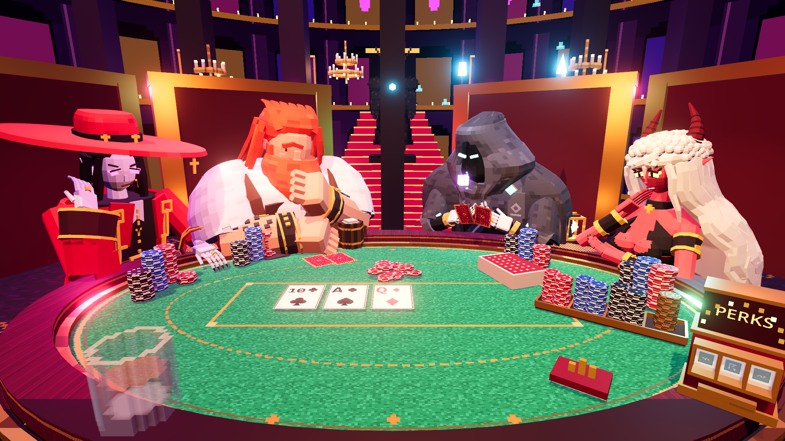

# House Edge

House Edge is an in-development, first-person supernatural poker roguelike. It starts with recognizable Texas Hold'em rules, then layers in persistent perks, readable counterplay, competitive nights, and a server-authoritative multiplayer match structure.

This showcase intentionally excludes private source code, deployment configuration, credentials, and operational infrastructure.

## Engineering highlights

- Godot 4.7.2 client and dedicated server using typed GDScript
- server-authoritative multiplayer over WebSockets
- deterministic poker evaluation, bot logic, and a growing automated rules suite
- reconnect tokens, private-table settings, and bots that fill empty seats
- versioned 3D character pipeline with reproducible visual review artifacts
- guarded deployment workflow with hash verification, rollback, and service checks

## Current status

The game is playable in development and remains under active construction. Core poker rules, competitive match flow, networking, five character seats, perks, bots, table interactions, and automated tests are implemented. Manual playtesting, balance work, audiovisual polish, and release packaging are ongoing.

## Design constraints

1. New players should recognize poker before modifiers become complex.
2. Counters should be learnable and soft rather than arbitrary shutdowns.
3. Information should live on the physical table whenever practical.
4. Generated 3D assets are treated as source material until retopology, rigging, and deformation tests are complete.

See [the architecture overview](docs/architecture.md) for a concise technical breakdown.

